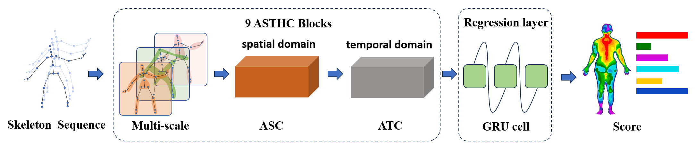
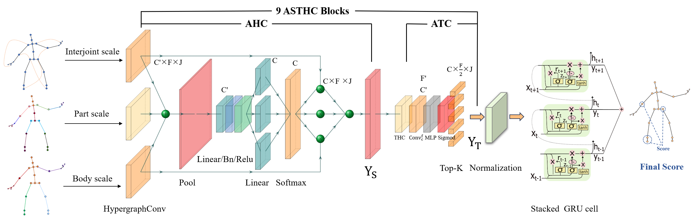
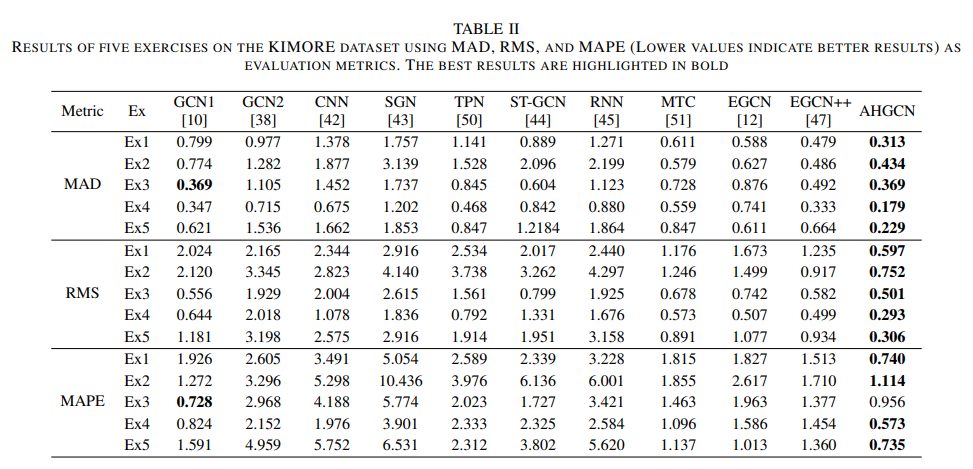
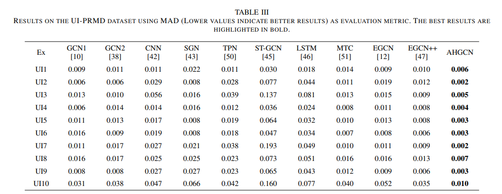
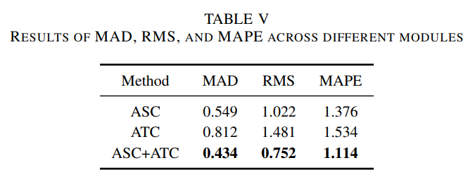
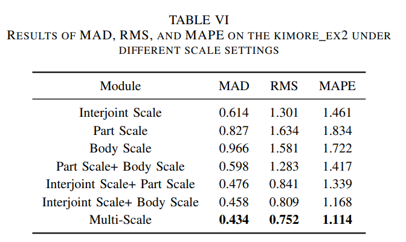

<div align="center">
<p align="center">
  
</p>
</div>

<div align="center">
<h1>Adaptive Multi-Scale Spatial-Temporal Hypergraph Neural Network for Skeleton-Based Human Action Assessment
</h1>
</div>

<p align="center">
  <i><b>Xun Li, Yongjian Zhang, Hongyun Cai, Changan Di, Minglai Shao and Hongbo Xie*</b></i><br>
  <i>Tianjin University, Nanjing University of Science and Technology</i><br>
  <i>HeBei University, Queensland University of Technology</i>
</p>

# Introduction

AHGCN predicts action-quality scores from skeleton sequences. ASC combines interjoint, part, and body features. ATC models cross-frame relationships using temporal hypergraphs and frame selection.

# Framework

<div align="center">
    
</div>
<div align="center">
Fig. 1.  Illustration of the adaptive multi-scale spatial-temporal hypergraph neural network.
</div>

# Datasets

<table>
  <tr>
    <th width="10%">Dataset</th>
    <th width="45%">Source Paper</th>
    <th width="25%">Download link</th>
    <th width="20%">Policy</th>
  </tr>
  <tr>
    <td>KIMORE</td>
    <td>•<a href="https://ieeexplore.ieee.org/document/8736767">The KIMORE Dataset: KInematic Assessment of MOvement and Clinical Scores for Remote Monitoring of Physical REhabilitation</a></td>
    <td><a href="https://drive.google.com/drive/folders/1b1anGzSytePiCUyoz8AlGMV2G54e_ZeC">Google Drive</a></td>
    <td>For the RGB data, interested researchers can contact: Prof. Marianna Capecci (m.capecci@staff.univpm.it) and Prof. Luca Romeo (luca.romeo@unimc.it) </td>
  </tr>
  <tr>
    <td>UI-PRMD</td>
    <td>•<a href="https://www.mdpi.com/2306-5729/3/1/2">A Data Set of Human Body Movements for Physical Rehabilitation Exercises</a></td>
    <td><a href="http://webpages.uidaho.edu/ui-prmd/">webpages.uidaho.edu</a></td>
    <td></td>
  </tr>
  <tr>
    <td>MIT-Skate</td>
    <td>•<a href="https://ieeexplore.ieee.org/abstract/document/8756030">Learning to Score Figure Skating Sport Videos</a></td>
    <td><a href="https://github.com/loadder/MS_LSTM.git">GitHub</a></td>
    <td></td>
  </tr>
</table>

# Environment and dependencies

Python 3.10, PyTorch 2.5.1, CUDA 11.8.

```bash
conda create -n ahgcn python=3.10 -y
conda activate ahgcn
python -m pip install torch==2.5.1 --index-url https://download.pytorch.org/whl/cu118
python -m pip install -r requirements.txt
python -c "import torch; print(torch.__version__); print(torch.cuda.is_available())"
```

Run commands from the repository root. Dataset files are supplied separately and are not included in the repository.

# Training and evaluation

MIT-Skate uses skeleton sequences extracted with OpenPose. Data are not included.

## Model options

- `--use_topk`: enable frame weighting and Top-k selection in blocks 4 and 7. Disabled by default.
- `--topk_ratio`: fraction of frames retained at each selection block. A value of 1 retains all frames and still applies weighting.
- `--gru_norm`: L1 (`1`) or L2 (`2`) normalization before the GRU.
- `--init_variant`: initialization scheme; see `python main.py --help`.
- `--tcn_dropout`: dropout in the temporal hypergraph branch. `--model_dropout` is unused.

## Training

KIMORE with frame selection:

```bash
python main.py --dataset Kimore_ex1 --batch_size 20 --num_epochs 800 --learning_rate 0.0003 --weight_decay 0.001 --tcn_dropout 0 --loss_beta 0.1 --lr_decay_epochs 400 --num_center 12 --sparse_lambda 0.003 --sparse_threshold 0.001 --temporal_k 4 --gru_norm 1 --init_variant all --use_topk --topk_ratio 0.5 --random_state 2 --device cuda --save_dir saved_models/Kimore_ex1_topk --model_name ahgcn
```

KIMORE without frame selection:

```bash
python main.py --dataset Kimore_ex1 --batch_size 20 --num_epochs 800 --learning_rate 0.0003 --weight_decay 0.001 --tcn_dropout 0 --loss_beta 0.1 --lr_decay_epochs 400 --num_center 12 --sparse_lambda 0.003 --sparse_threshold 0.001 --temporal_k 4 --gru_norm 1 --init_variant all --random_state 2 --device cuda --save_dir saved_models/Kimore_ex1_no_topk --model_name ahgcn
```

UI-PRMD and MIT-Skate examples (adjust hyperparameters for each dataset):

```bash
python main.py --dataset UI_PRMD_ex1 --batch_size 10 --num_epochs 800 --use_topk --topk_ratio 0.5 --device cuda --save_dir saved_models/UI_PRMD_ex1 --model_name ahgcn
python main.py --dataset MIT_Skate --batch_size 4 --num_epochs 800 --use_topk --topk_ratio 0.5 --device cuda --save_dir saved_models/MIT_Skate --model_name ahgcn
```

## Checkpoints and splits

KIMORE and UI-PRMD use sample-wise random splits: 20% test, then 20% of the remaining pool for validation, giving approximately 64%/16%/20%. `--random_state` controls both splitting and training randomness. Each run saves its exact indices in `ahgcn_split.npz`.

For rehabilitation datasets, training saves `ahgcn_best_mae.pth`, `ahgcn_best_rmse.pth`, and `ahgcn_best_mape.pth`, selected by the respective validation metrics, and evaluates each on the test set. `ahgcn_best.pth` is the validation-RMSE checkpoint alias. Each checkpoint records the selected epoch, all validation metrics at that epoch, model configuration, and weights.

MIT-Skate selects 100 training samples and uses the remaining samples for testing (71 with the full 171-video dataset). It has no separate validation split and saves `ahgcn_final.pth` after the specified number of epochs.

## Evaluation

Use the checkpoint and split file from the same run. Model settings are loaded from the checkpoint:

```bash
python TestModel.py --dataset Kimore_ex1 --model_path saved_models/Kimore_ex1_topk/ahgcn_best_rmse.pth --split_path saved_models/Kimore_ex1_topk/ahgcn_split.npz --batch_size 20 --device cuda
python TestModel.py --dataset MIT_Skate --model_path saved_models/MIT_Skate/ahgcn_final.pth --split_path saved_models/MIT_Skate/ahgcn_split.npz --batch_size 4 --device cuda
```

Use a separate output directory for each run.

## Code structure

- `graph/Hypergraph.py`: spatial and temporal hypergraph construction, aggregation, and caching.
- `model/AdaptivescaleHyperConv.py`: interjoint, part and body streams with adaptive scale fusion.
- `model/AdaptivescaleTimConv.py`: temporal hypergraph convolution and optional frame selection.
- `model/module.py`: ASTHC blocks, input normalization, pooling and GRU regression.

| Argument | Default | Meaning |
| --- | --- | --- |
| `--num_center` | 5 | Movement-selected spatial centers |
| `--sparse_lambda` | 0.01 | Sparse reconstruction L1 penalty |
| `--sparse_threshold` | 0.001 | Membership coefficient threshold |
| `--sparse_iter` | 1000 | Maximum solver iterations |
| `--sparse_tol` | 0.000001 | Solver convergence tolerance |
| `--temporal_k` | 4 | Cross-frame neighbors per hyperedge |
| `--use_topk` | off | Enable frame weighting and selection |
| `--topk_ratio` | 0.5 | Retention ratio at each pooling block |
| `--gru_norm` | 1 | GRU input normalization norm |
| `--init_variant` | original | Module initialization scheme |

`--hypergraph_cache` accepts `auto` (default), `cuda`, `cpu`, or `none`. Automatic caching uses GPU memory when available, otherwise CPU memory. Use `none` when input coordinates change during training.

## Tests

```bash
python -m unittest discover -s tests -p "test_*.py" -v
```

Tests cover hypergraph construction, aggregation, input layout, frame selection, gradients, and caching using synthetic inputs.

# Results

### Method comparison

<div align="center">
    
</div>

<div align="center">
    
</div>

### Scale comparison

<div align="center">
    
</div>

<div align="center">
    
</div>

# Acknowledgements

This implementation builds on [ST-GCN](https://ojs.aaai.org/index.php/aaai/article/view/12328) and [STGCN-rehab](https://ieeexplore.ieee.org/abstract/document/9709340).

# Contact

Xun Li: [lixun@tju.edu.cn](mailto:lixun@tju.edu.cn)
