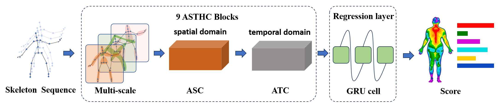
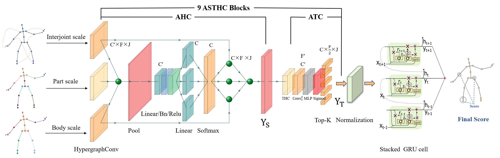
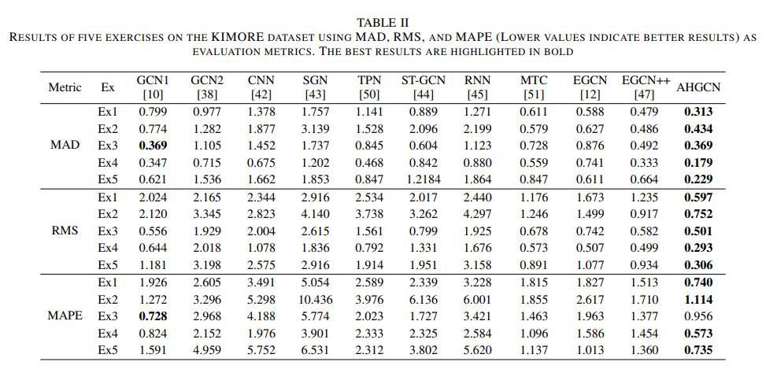
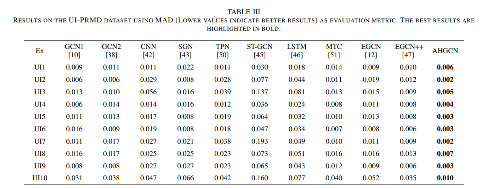
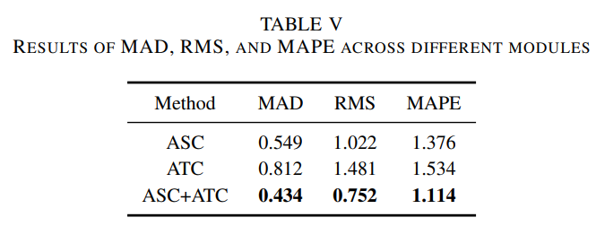
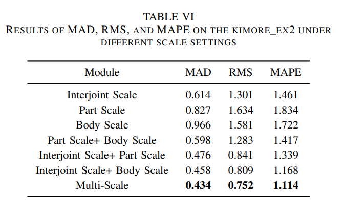

<div align="center">
<p align="center">
  
</p>
</div>

<div align="center">
<h1>Adaptive Multi-Scale Spatial-Temporal Hypergraph Neural Network for Skeleton-Based Human Action Assessment
</h1>
</div>


<p align="center">
  <i><b>Xun Li, Yongjian Zhang, Hongyun Cai, Changan Di and Hongbo Xie*</b></i><br>
  <i>Tianjin University, Nanjing University of Science and Technology</i><br>
  <i>HeBei University, Queensland University of Technology</i>
</p>


# 📌 Introduction

- We propose a unified multi-scale hypergraph convolution framework that adaptively extracts spatial context from skeleton data while aggregating temporal dependency features to improve human action assessment.
- By representing the human skeleton as a hypergraph, we design an Adaptive Spatial
Convolution (ASC) mechanism that explicitly captures and fuses high-order joint interaction across multiple spatial scales.
- We introduce an Adaptive Temporal Convolution (ATC) on hypergraph that replaces conventional temporal convolutions and enables effective modeling of interactions across
multiple frames.


# 🖇️ Framework

<div align="center">
    
</div>
<div align="center">
Fig. 1.  Illustration of the adaptive multi-scale spatial-temporal hypergraph neural network.
</div>


# 🤗 Datesets

<table>
  <tr>
    <th width="10%">Dataset</th>
    <th width="45%">Source Paper</th>
    <th width="25%">Download link</th>
    <th width="20%">Policy</th>
  </tr>
  <tr>
    <td>KIMORE</td>
    <td>•<a href="https://ieeexplore.ieee.org/document/8736767">The KIMORE Dataset: KInematic Assessment of MOvement and Clinical Scores for Remote Monitoring of Physical REhabilitation</a></td>
    <td><a href="https://drive.google.com/drive/folders/1b1anGzSytePiCUyoz8AlGMV2G54e_ZeC">Google Drive</a></td>
    <td>For the RGB data, interested researchers can contact: Prof. Marianna Capecci (m.capecci@staff.univpm.it) and Prof. Luca Romeo (luca.romeo@unimc.it) </td>
  </tr>
  <tr>
    <td>UI-PRMD</td>
    <td>•<a href="https://www.mdpi.com/2306-5729/3/1/2">A Data Set of Human Body Movements for Physical Rehabilitation Exercises</a></td>
    <td><a href="http://webpages.uidaho.edu/ui-prmd/">webpages.uidaho.edu</a></td>
    <td></td>
  </tr>
  <tr>
    <td>MIT-Skate</td>
    <td>•<a href="https://ieeexplore.ieee.org/abstract/document/8756030">Learning to Score Figure Skating Sport Videos</a></td>
    <td><a href="https://github.com/loadder/MS_LSTM.git">GitHub</a></td>
    <td></td>
  </tr>
</table>

# 🛠 Environment & Dependencies

```bash
- Python 3.8+ 
- CUDA 11.6 
- pip install -r requirements.txt
```


# 📖 Quick Start
(1) Training.

```bash
KIMORE Dataset: python main.py --dataset Kimore_ex2 --batch_size 20 --num_epochs 800 --learning_rate 1e-4 --weight_decay 0.001 --device cuda
UI-PRMD Dataset: python main.py --dataset UI_PRMD_ex1 --batch_size 20 --num_epochs 800 --learning_rate 1e-4 --weight_decay 0.001 --device cuda
```

(2) Testing.

```bash
KIMORE Dataset: python TestModel.py --dataset Kimore_ex2 --model_path 'path'
UI-PRMD Dataset: python TestModel.py --dataset UI_PRMD_ex1 --model_path 'path'
```


# 💡 Performance

### 📊 The State-of-the-art Performance

<div align="center">
    
</div>

<div align="center">
    
</div>

### 📊  Different Scale Performance

<div align="center">
    
</div>

<div align="center">
    
</div>


# 🙏 Acknowledgements

This work is implemented based on [ST-GCN](https://ojs.aaai.org/index.php/aaai/article/view/12328) and [STGCN-rehab](https://ieeexplore.ieee.org/abstract/document/9709340). We sincerely thank the authors of these projects for their valuable contributions to the open-source community.


# 📧 Contact

This repository is under continuous maintenance and updates. We will keep improving the code and documentation in future updates.<br>
If you have any questions, feel free to reach out to me via email: [lixun@tju.edu.cn]

